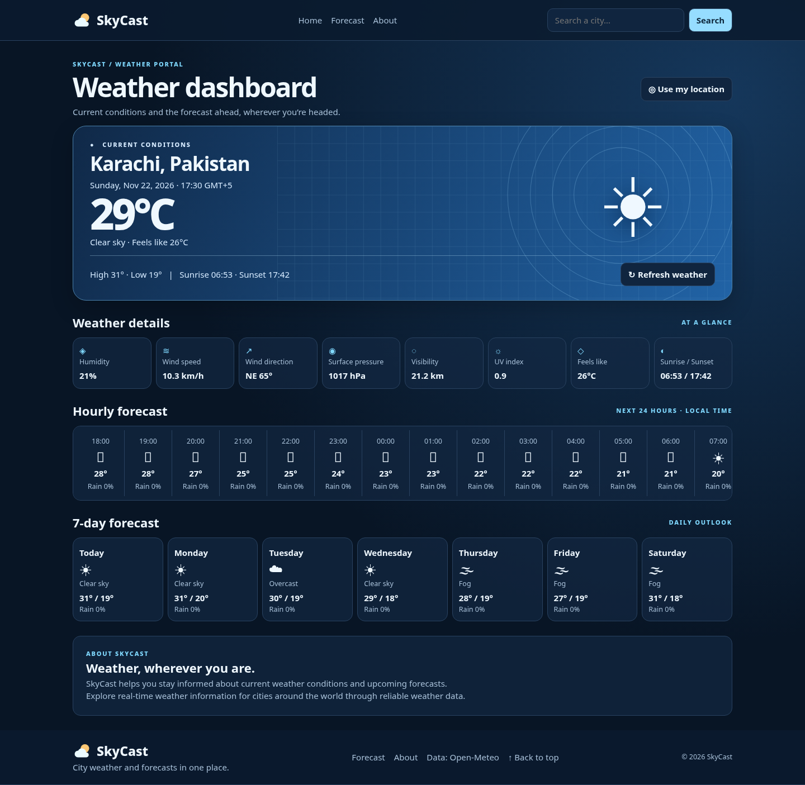
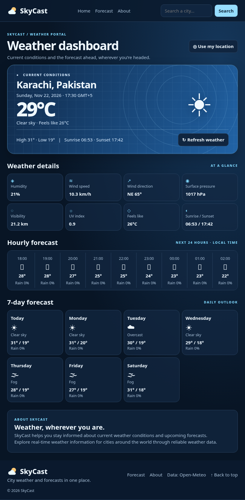
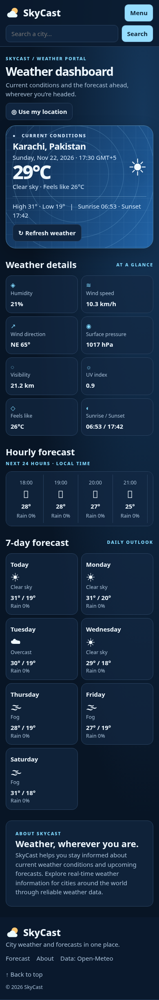

# SkyCast — Live Weather Forecast Portal

**Madiha Khan · Progree · Frontend Development Internship · Task 3**

SkyCast is a responsive weather dashboard built to demonstrate browser-based REST API integration without frameworks or a backend. It opens to Karachi, Pakistan and lets users look up worldwide forecasts by city or use their device location.

## Run locally

Extract the archive, open a terminal in `SkyCast/`, and run:

```sh
python -m http.server 8000
```

Visit `http://localhost:8000`. An internet connection is required for weather data. For deployment, serve these files on any HTTPS static host. Browser geolocation requires a secure context (HTTPS or localhost) and user permission.

## Features and technologies

- HTML5, CSS Grid and Flexbox, vanilla JavaScript, Fetch API, async/await, and localStorage.
- Current conditions, feels-like temperature, daily high and low, sunrise and sunset, humidity, wind speed and direction, surface pressure, visibility, and UV index.
- Scrollable 24-hour outlook and responsive seven-day forecast. Weather codes drive the condition labels and icons; current conditions also drive the hero accent.
- City matching for ambiguous names, five recent searches, manual refresh, and optional geolocation.
- Loading, no-results, offline and API failure messages; the last successful forecast remains visible if a later request fails.

## REST API integration

1. The [Open-Meteo Geocoding API](https://open-meteo.com/en/docs/geocoding-api) (`/v1/search`) returns matching places and their coordinates. If there is more than one match, the user chooses a location.
2. The [Open-Meteo Forecast API](https://open-meteo.com/en/docs) (`/v1/forecast`) returns `current`, `hourly`, and `daily` JSON for those coordinates. `timezone=auto` requests local timestamps; temperatures use Celsius and wind uses km/h. Karachi and device geolocation supply coordinates directly.
3. JavaScript maps weather codes, renders the response, and uses the current local hour's hourly values for visibility and UV. Only successful city searches are saved to localStorage; device coordinates are sent to the forecast endpoint when requested but are not persisted by the app.

## Project structure

```text
SkyCast/
├── index.html          # Dashboard and semantic page structure
├── style.css           # Theme and responsive layouts
├── script.js           # API requests, rendering and interactions
├── images/atmosphere.svg
├── icons/sky.svg
├── screenshots/
│   ├── desktop.png
│   ├── tablet.png
│   └── mobile.png
└── README.md
```

## Testing

Headless Chromium with Playwright on November 22, 2026:

- Verified live API calls, Karachi default, eight details cards, 24 hourly entries, seven daily entries, and refresh.
- Verified Enter submission with Tokyo, matching-city selection, Search-button submission with an unknown city, and recent-city persistence and selection after reload.
- Verified location with permission granted and browser-supplied test coordinates; verified the mobile menu opens and closes.
- Simulated offline and HTTP 503 failures. No uncaught JavaScript exceptions were recorded. The 503 intentionally generated a failed-resource response.
- Checked for page-level horizontal overflow at widths of 320, 375, 390, 430, 768, 820, 1024, 1366, and 1440 CSS pixels. The hourly strip deliberately scrolls within its own container.
- Not verified on physical devices or in other browser engines; actual device location accuracy was not tested.

## Limitations

Forecasts are model estimates, not on-site measurements. A dash indicates missing numeric data. The UI's “Rain” label represents Open-Meteo precipitation probability (which may include snow), and the daily value is the maximum hourly probability for that day. Geolocation displays “Your location” rather than reverse-geocoding a place name. The public API is subject to provider availability and non-commercial usage limits. No offline forecast is stored across page reloads.

## Screenshots

Actual browser captures with live Karachi weather. Viewport widths: 1440 px (desktop), 820 px (tablet), and 390 px (mobile).





Weather data: [Open-Meteo](https://open-meteo.com/).
